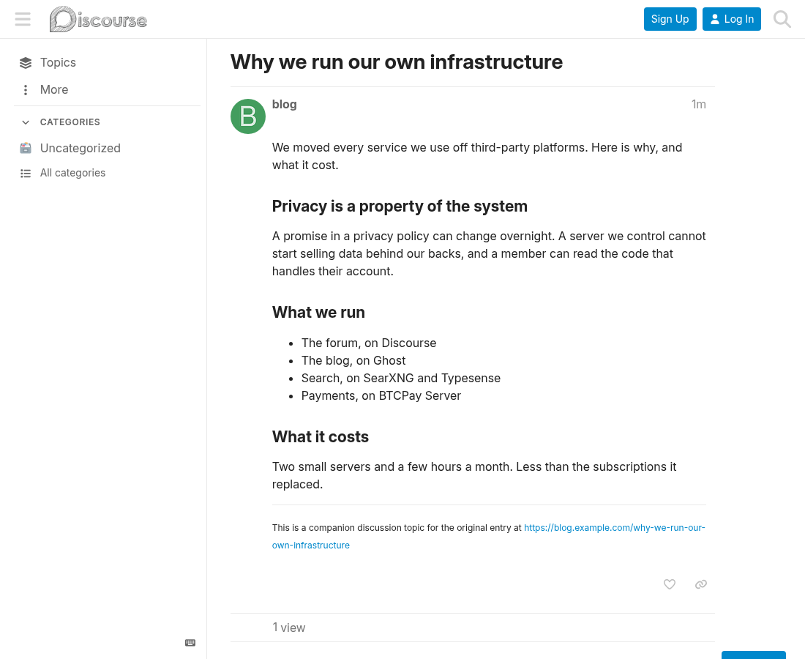

# Full embedded posts

**ENGLISH** | [ESPAÑOL](README.es.md)

Maintained by Criptonautas. Not affiliated with or endorsed by Discourse (Civilized Discourse Construction Kit, Inc.).

Discourse theme component. Topics created by the [Embedding](https://meta.discourse.org/t/embedding-discourse-comments-via-javascript/31963)
feature render the whole article on load, instead of an excerpt plus a "Show more" button.

## Install

Admin → Customize → Themes → Components → Install → From a git repository, with this repo's URL.

## Folding long articles

Optional. List tags in `collapse tags` and the first post of topics carrying any of them
folds to a `collapsed height` preview with a "Show more" button. Short articles stay as
they are, replies are never folded, and nothing changes inside the blog's own comments
embed. The fold is visual only: the whole text is still on the page, so search engines and
screen readers read all of it.

## Notes

Truncation happens at import: the excerpt becomes the post, the full article is kept in
`topic_embeds.embed_content_cache`. The component fetches it through the same
`/posts/:id/expand-embed` endpoint the button uses — server-cached, so your blog is not
re-crawled. If that request fails, the button is left in place.

Turning off the `embed truncate` site setting only affects *future* imports; those aren't
expandable and the component no-ops on them. Already-imported topics keep the excerpt in the
database until a rails-console `TopicEmbed.import` reimport — this component is what makes
them render in full meanwhile.

## License

MIT. See [LICENSE](LICENSE).

Text of this README under [CC BY-NC-SA 4.0](CC-BY-NC-SA-4.0.txt).
